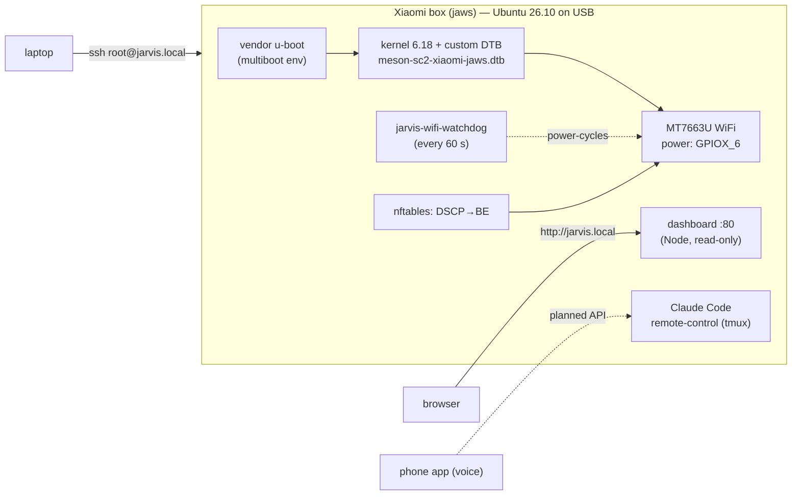

# xiaomibox-ubuntu

**Ubuntu 26.10 on a Xiaomi TV Box S (2nd Gen), turned into an always-on home server that runs Claude Code.**

A ~$40 Android TV streaming box (Amlogic S905X4, 2 GB RAM) boots mainline Linux from USB, with the stock bootloader still locked and no root. It reaches the network over its internal WiFi chip, comes back on its own after a power cut, and serves a status dashboard at `http://jarvis.local`.

The long-term goal is "Jarvis": a voice assistant that runs on the box, with Claude Code as the brain, and controls the house and the TV. A phone app handles voice.

> Status: working. Booting, WiFi, SSH, auto-start, the dashboard and Claude Code are all verified on the device. The WiFi chip still has a firmware bug, which is now contained (see [Engineering notes](#engineering-notes)). An overnight stability run is pending.

---

## What works

| Area | State | Evidence |
|---|---|---|
| Boot Ubuntu 26.10 (kernel 6.18.59) from USB | ✅ | locked bootloader, no root, no unlock |
| Cold boot straight into Ubuntu (no Android) | ✅ | power on → SSH in ~43 s, also with HDMI unplugged |
| Android kept as fallback | ✅ written, not exercised | u-boot `cmd_boot_org=run storeboot` |
| Internal WiFi (MediaTek MT7663U, 5 GHz) | ✅ with workarounds | power-GPIO fix, BT blacklist, DSCP steering, watchdog |
| SSH, `jarvis.local` (mDNS), status dashboard | ✅ | `http://jarvis.local` |
| Claude Code 2.1.x (native ARM64) + Remote Control | ✅ | systemd + tmux, starts on boot |
| zram swap, eMMC (Android) full backup | ✅ | backup verified byte-for-byte with SHA-256 |
| HDMI audio | ❌ | not supported on S905X4 by this kernel. Not needed: voice goes through the phone |

## Hardware

| | |
|---|---|
| Device | Xiaomi TV Box S 2nd Gen, model **MDZ-28-AA**, codename **`jaws`** (`MiTV-AFKR0`) |
| SoC | Amlogic **S905X4** (`sc2`), 4× Cortex-A55 |
| RAM / storage | 2 GB / 8 GB eMMC (Android left intact) |
| WiFi + BT | MediaTek **MT7663** on an internal USB bus |
| Ports | 1× USB-A (OTG), HDMI, power. No Ethernet jack |
| Stock firmware | Android 11 (build 683), u-boot `01.01.230202`, AVB locked |

## How it fits together



## Quick start

> **New here? Follow the step-by-step [tutorial](docs/TUTORIAL.md)**: every command, what you should see, and troubleshooting. The summary below is for people who have done this before.

> ⚠️ This writes to USB drives and, optionally, to the box's bootloader environment. Read the scripts first. Back up the eMMC before changing anything (step 6 shows how).

**You need:** the box with ADB over network enabled, a USB stick (8 GB+), a Mac or Linux PC with Docker and `adb`.

1. **Download the base image** from [devmfc/debian-on-amlogic](https://github.com/devmfc/debian-on-amlogic/releases) (`Devmfc_Ubuntu-Stonking_*.img.xz`) and decompress it.
2. **Fill in WiFi credentials.** `cp .env.example .env`, then edit it. The PSK is stored in the image as a hash, not as plaintext.
3. **Customize the image:**
   ```sh
   ./scripts/prepare-image.sh path/to/ubuntu.img
   ```
   This adds the MT7663 firmware (SHA-256 pinned), headless WiFi, an SSH key, the custom DTB, and the services in `overlay/`.
4. **Flash it** to the USB stick (`dd` to the raw device; double-check the disk number).
5. **First boot.** Plug the stick into the box, boot Android, then:
   ```sh
   adb connect <box-ip>:5555     # on macOS, use scripts/adb-bridge.py if this says "No route to host"
   adb reboot update             # vendor u-boot runs the stick's aml_autoscript
   ssh -i ~/.ssh/xiaomibox_ed25519 root@<box-ip>
   ```
6. **On the box (optional, recommended):** back up the eMMC, then make Ubuntu start on power-on:
   ```sh
   dd if=/dev/mmcblk1 bs=4M | zstd -3 -T0 -o /root/emmc-backup/mmcblk1.img.zst   # plus boot0/boot1
   /root/aml-multiboot-setup.sh   # devmfc script: boot order sd → usb → emmc → Android
   ```
7. **Extras installed live on the box:** `apt install nodejs avahi-daemon nftables systemd-zram-generator`, then the [native Claude Code installer](https://docs.claude.com/en/docs/claude-code/setup).

## Engineering notes

Seven problems stood between "it boots" and "it's a server". Each fix is backed by a log line or a measurement in [`docs/research-log.md`](docs/research-log.md).

**1. The kernel booted, then waited forever for its root disk.** The box's only USB port is OTG. The generic S905X4 device tree leaves it in `dr_mode = "otg"`, and with no ID pin it switched to *device* mode (`dwc3-meson-g12a: switching to Device Mode`), so the USB stick never appeared. Fix: a custom DTB with the USB glue forced to `host` and the dwc2 peripheral controller disabled.

**2. The WiFi chip didn't exist on the bus.** The MT7663 sits on an internal USB port, and its power enable is **GPIOX_6** (line 56 of the SC2 GPIO bank). The generic DTB ties that pin to an SDIO power sequencer for an empty SDIO slot. When the slot fails to initialize, the pin drops and the chip powers off. Fix: disable the empty SDIO path and drive GPIOX_6 from userspace. Android's sysfs gave the clue: a `wlpm` power-management module and an exported GPIO, mapped through Amlogic's `meson-sc2-gpio.h`.

**3. WiFi firmware failed to load.** The chip is a WiFi + Bluetooth combo. `btusb` and `mt7663u` probed it at the same moment and raced for the chip's patch semaphore (`Failed to get patch semaphore`). Fix: blacklist `btusb`, which the project doesn't need.

**4. A hung chip can't be fixed by reloading the driver.** After `Message … timeout` or `timed out waiting for pending tx`, reloading `mt7663u` doesn't help. Fix: `jarvis-wifi-power` cuts GPIOX_6 for 2 s, waits for `0e8d:7663` to re-enumerate, then loads the driver. A watchdog runs that sequence when the link breaks.

**5. Pings passed, but SSH died.** This one took three wrong hypotheses: USB storage stalls, systemd socket activation, and the generic WiFi driver. All three were disproven with logs. During an outage the box's own checks passed, while `sshd` logged every client attempt as `[preauth]` and the client never got the banner. A per-queue probe found the cause: `failed_ac=[VO] tcp_ok=yes`. The MT7663 hangs **only its WMM voice (VO) TX queue**, so ICMP and plain TCP (best effort) keep working while DSCP-marked traffic like SSH vanishes. Fix: nftables clears DSCP on all non-ICMP `wlan0` traffic, which can only lower priority, never raise it. ICMP keeps its marking so the watchdog can still count VO hangs. The watchdog ignores those hangs instead of power-cycling, which was costing ~1 minute of downtime each time.

**6. `jarvis.local` silently became `jarvis-2.local`.** When the WiFi interface was re-added during a power cycle, avahi heard its own announcement and treated it as a name conflict. Fix: avahi on IPv4 and `wlan0` only, and the watchdog checks the published name over D-Bus and reclaims it.

**7. macOS refused to let `adb` talk to the box** (`No route to host`), even though `nc` and Python could reach it. macOS Local Network privacy was blocking the `adb` binary. Fix: [`scripts/adb-bridge.py`](scripts/adb-bridge.py), a tiny localhost TCP relay.

**Measured:** eMMC reads at 176 MB/s and the USB stick at 32 MB/s (direct I/O, 256 MiB). Moving the root filesystem to the eMMC or a USB SSD is the obvious next speed-up.

## Repository layout

```
scripts/
  prepare-image.sh        build a ready-to-boot image (firmware, WiFi, DTB, services)
  collect-device-info.sh  read-only hardware facts from Android over ADB
  adb-bridge.py           localhost relay for adb on macOS
overlay/                  files installed into the image (systemd units, watchdog, nftables, modprobe)
dashboard/                read-only status page (Node built-ins only, no npm deps)
docs/
  research-log.md         dated lab notebook: every hypothesis, test and correction
  device-info/            raw evidence: diagnostics, boot photos, Android device tree
```

## Roadmap

- [x] Boot Ubuntu, WiFi, SSH, auto-start, dashboard, Claude Code
- [ ] Overnight WiFi stability run
- [ ] SSH: key-only login, change the default root password
- [ ] Jarvis API: `claude -p` behind a small authenticated HTTP service for the phone app
- [ ] TV control (HDMI-CEC / webOS) and home automation (Home Assistant / Matter)
- [ ] Faster storage: root on eMMC or a USB SSD

## Credits

- [devmfc/debian-on-amlogic](https://github.com/devmfc/debian-on-amlogic): mainline kernel, Ubuntu image, boot scripts, multiboot.
- [linux-firmware](https://git.kernel.org/pub/scm/linux/kernel/git/firmware/linux-firmware.git): MediaTek MT7663 firmware (downloaded at build time, not redistributed here).
- Community notes on rooting `jaws` ([gist](https://gist.github.com/x011/d2f4f52f83861247840c5e5488e080d1)), and the mt76 and Armbian issue trackers.
- Built with [Claude Code](https://claude.com/claude-code).

## Disclaimer

Not affiliated with Xiaomi, Amlogic or MediaTek. Writing to a device's bootloader environment can make it unbootable. You do this at your own risk, on hardware you own.

## License

[MIT](LICENSE) for the code in this repository. Third-party components keep their own licenses.
